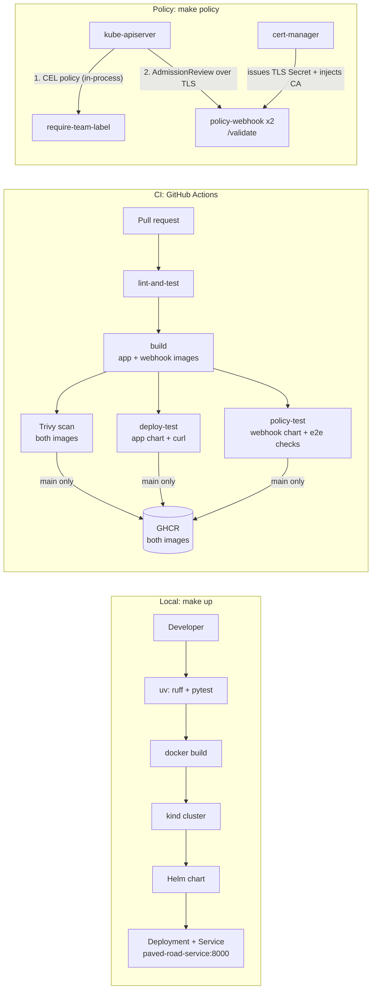

# paved-road

> A ready-to-copy template for teams starting a new Python service: a FastAPI app,
> a CI pipeline with security scanning, and a Helm chart that deploys to a local
> Kubernetes cluster with one command.

[](https://github.com/Shirojoufu/Service-Template/actions/workflows/ci.yml)

## Demo

`make up` from a fresh clone, trimmed to the key lines:

```
$ time make up
uv run ruff check
All checks passed!
uv run pytest -v
tests/test_main.py::test_healthz PASSED
tests/test_main.py::test_hello PASSED
docker build -t paved-road:dev .
kind create cluster --name paved-road
 ✓ Starting control-plane 🕹️
kind load docker-image paved-road:dev --name paved-road
helm upgrade --install paved-road charts/service ... --wait
STATUS: deployed
Pod is ready. Run 'kubectl port-forward svc/paved-road-service 8000:8000'

real    0m40.346s

$ curl localhost:8000/hello/graham
{"message":"Hello graham, from Service_Template"}
```

## Prerequisites

Install these before running anything below. Versions are what this repo was
last tested with (2026-10-20) — newer patch/minor versions should be fine.

| Tool | Version tested | Windows (choco) | Linux (apt) | macOS (brew) |
|---|---|---|---|---|
| [Docker](https://docs.docker.com/get-docker/) | 29.9.1 | `choco install docker-desktop` | `sudo apt-get install docker.io` | `brew install --cask docker` |
| [make](https://www.gnu.org/software/make/) | GNU Make 4.4.1 | `choco install make` | `sudo apt-get install make` | `brew install make` |
| [kind](https://kind.sigs.k8s.io/) | 0.30.0 | `choco install kind` | [download the binary](https://kind.sigs.k8s.io/docs/user/quick-start/#installation) | `brew install kind` |
| [kubectl](https://kubernetes.io/docs/tasks/tools/) | v1.37.1 | `choco install kubernetes-cli` | [add the Kubernetes apt repo](https://kubernetes.io/docs/tasks/tools/install-kubectl-linux/) | `brew install kubectl` |
| [Helm](https://helm.sh/) | v4.1.4 | `choco install kubernetes-helm` | [official install script](https://helm.sh/docs/intro/install/) | `brew install helm` |
| [uv](https://docs.astral.sh/uv/) | 0.13.1 | `choco install uv` | `curl -LsSf https://astral.sh/uv/install.sh \| sh` | `brew install uv` |

> On Windows, `choco install kind` has been seen pulling in `docker-desktop`
> as an unwanted dependency and failing on a lock file; if that happens,
> grab the [kind binary](https://kind.sigs.k8s.io/docs/user/quick-start/#installation)
> directly. If `choco install make` fails the same way, `winget install
> ezwinports.make` is a reliable fallback.

## Quick start

```
make up      # test, build, load into a local kind cluster, and deploy via Helm
make down    # tear down the kind cluster
```

**Goal: first deploy in under 10 minutes.**

| Time to first deploy (`time make up`, fresh clone) | |
|---|---|
| **Cold:** nothing cached | **1m 44.8s** |
| **Warm:** images and packages already cached | **40.3s** |

The cold run started with no Docker images, no build cache, no Python
packages and no Python interpreter. Only the tools in
[Prerequisites](#prerequisites) were installed. Both runs used Docker Desktop on
Windows and were measured on 2026-10-20 (warm) and 2026-10-21 (cold).

After `make up`, forward the service and hit it:

```
kubectl port-forward svc/paved-road-service 8000:8000
curl localhost:8000/hello/graham
```

### Policy webhook (`policy/`)

An admission webhook that rejects Deployments without a `team` label, resource
requests and limits, or a pinned image tag. The `team` rule is also written as
a built-in CEL policy for comparison ([ADR 0004](docs/adr/0004-custom-webhook-vs-cel.md)).
With a cluster already up from `make up`:

```
make policy        # build the webhook image and install charts/policy-webhook
make policy-test   # check the policies against the live cluster
```

`make policy` installs [cert-manager](https://cert-manager.io/) (which issues
the webhook's TLS cert), creates the `policy`, `team-a` and `team-b`
namespaces with their RBAC, and installs the
[policy-webhook chart](charts/policy-webhook/). It returns only once the
policies are actually enforced. It is a separate target from `up`, since the
plain app doesn't need it.

`make policy-test` runs [policy/tests/e2e.sh](policy/tests/e2e.sh), which sends
compliant and non-compliant Deployments to the apiserver as server-side dry
runs, so nothing is created:

```
PASS: no team label (CEL policy) rejected: metadata.labels.team is required
PASS: :latest image (webhook) rejected: must not use the 'latest' tag
PASS: untagged image (webhook) rejected: has no tag
PASS: no resource requests/limits (webhook) rejected: missing resources.limits.memory
PASS: compliant Deployment admitted
PASS: non-compliant Deployment in an excluded namespace (kube-system) admitted
All policy checks passed
```

Or try it by hand:

```
$ kubectl create deployment bad --image=nginx:latest -n team-a
... ValidatingAdmissionPolicy 'policy-webhook-require-team-label' ...
    denied request: metadata.labels.team is required
```

A Deployment that has the `team` label but uses `:latest` and no resources
passes the CEL policy and is rejected by the webhook instead:

```
admission webhook "deployments.policy.paved-road.dev" denied the request:
image 'nginx:latest' must not use the 'latest' tag; ...
container 'web' is missing resources.requests.cpu; ...
```

## Using this template

1. Click **Use this template** on GitHub to create your own repo from this one.
2. Rename the service. Everything is named `paved-road`, so one find-and-replace
   covers the Makefile, CI, both charts and the docs:

   ```
   git grep -l paved-road | xargs sed -i 's/paved-road/my-service/g'
   ```

   Also change the display name in [app/main.py](app/main.py)
   (`"Service_Template"`), which the app returns in its responses.

3. Point the CI badge at the top of this README at your repo.
4. Set the `team` label in [charts/service/values.yaml](charts/service/values.yaml).
   The policy webhook rejects Deployments without one.
5. Push to `main`. CI publishes the images to `ghcr.io/<your-account>/...`
   automatically, as **private** packages. Make them public in each package's
   settings on GitHub if you need to.

The policy webhook in [policy/](policy/) and
[charts/policy-webhook/](charts/policy-webhook/) is platform tooling, installed
once per cluster, not per service. A team that only needs the service can
delete those two directories, the `policy-*` targets in the Makefile, and the
`policy` entries and `policy-test` job in CI.

## Architecture



- **App:** FastAPI in [app/](app/), served by uvicorn on port 8000. `/healthz` and
  `/readyz` back the chart's liveness and readiness probes.
- **Image:** built with uv from `uv.lock`, runs as a non-root user, with pip
  removed so its vendored packages don't show up in the scan.
- **CI:** every PR runs lint and tests, builds both the app and webhook images,
  and scans each with Trivy, failing on fixable HIGH/CRITICAL findings. In
  parallel, `deploy-test` installs the app chart into a throwaway kind cluster
  and curls the running pod, and `policy-test` installs the webhook chart and
  runs the same `make policy-test` checks used locally. On `main`, both images
  that passed are pushed to GHCR, not rebuilt. Third-party actions, the uv
  image and the runner OS are pinned, and Dependabot keeps them current.
- **Policy:** a FastAPI webhook in [policy/](policy/) rejects Deployments
  without a `team` label, resource requests/limits, or a pinned image tag. It
  runs as two replicas under the `restricted` Pod Security profile with
  `failurePolicy: Fail`, and skips system namespaces so it can never lock
  itself out ([ADR 0003](docs/adr/0003-webhook-failure-policy.md)). Teams get
  namespace-scoped RBAC that lets them manage workloads but not read Secrets.

## Decisions

Architecture decision records live in [docs/adr/](docs/adr/):

- [0001: Why uv](docs/adr/0001-why-uv.md)
- [0002: Helm over Kustomize](docs/adr/0002-helm-over-kustomize.md)
- [0003: Webhook failure policy (Ignore vs Fail)](docs/adr/0003-webhook-failure-policy.md)
- [0004: Custom webhook vs built-in CEL policies vs Kyverno](docs/adr/0004-custom-webhook-vs-cel.md)

## What I'd do next

1. **Close the first-install gap.** Helm creates the webhook registration at the
   same time as the webhook pods, so for a few seconds on first install the
   apiserver can call a webhook that isn't serving yet and reject Deployments
   in team namespaces. Upgrades aren't affected. Registering the webhook in a
   second step, once the pods are ready, would remove the window.
2. **Version and publish releases.** Images are tagged only by commit SHA and
   the charts are only installable from a clone. Semver tags and publishing
   both charts to GHCR as OCI artifacts would let other repos depend on a
   version.
3. **Deploy beyond kind.** There is no staging environment. A GitOps tool such
   as Argo CD, pointed at the published charts and images, would be the next
   step from a local golden path to a real one.
4. **Retire one implementation of the `team` rule.** It exists in both the
   webhook and CEL for comparison. Keeping both means two places to change it
   ([ADR 0004](docs/adr/0004-custom-webhook-vs-cel.md)).
