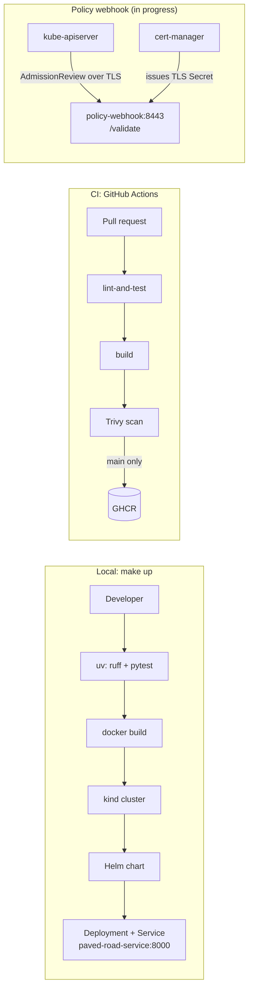

# paved-road

> A ready-to-copy template for teams starting a new Python service: a FastAPI app,
> a CI pipeline with security scanning, and a Helm chart that deploys to a local
> Kubernetes cluster with one command.

[](https://github.com/Shirojoufu/Service-Template/actions/workflows/ci.yml)

## Demo

`make up` from a fresh clone, trimmed to the key lines:

```
$ time make up
uv run ruff check
All checks passed!
uv run pytest -v
tests/test_main.py::test_healthz PASSED
tests/test_main.py::test_hello PASSED
docker build -t paved-road:dev .
kind create cluster --name paved-road
 ✓ Starting control-plane 🕹️
kind load docker-image paved-road:dev --name paved-road
helm upgrade --install paved-road charts/service ... --wait
STATUS: deployed
Pod is ready. Run 'kubectl port-forward svc/paved-road-service 8000:8000'

real    0m40.346s

$ curl localhost:8000/hello/graham
{"message":"Hello graham, from Service_Template"}
```

## Prerequisites

Install these before running anything below. Versions are what this repo was
last tested with (2026-10-20) — newer patch/minor versions should be fine.

| Tool | Version tested | Windows (choco) | Linux (apt) | macOS (brew) |
|---|---|---|---|---|
| [Docker](https://docs.docker.com/get-docker/) | 29.9.1 | `choco install docker-desktop` | `sudo apt-get install docker.io` | `brew install --cask docker` |
| [make](https://www.gnu.org/software/make/) | GNU Make 4.4.1 | `choco install make` | `sudo apt-get install make` | `brew install make` |
| [kind](https://kind.sigs.k8s.io/) | 0.30.0 | `choco install kind` | [download the binary](https://kind.sigs.k8s.io/docs/user/quick-start/#installation) | `brew install kind` |
| [kubectl](https://kubernetes.io/docs/tasks/tools/) | v1.37.1 | `choco install kubernetes-cli` | [add the Kubernetes apt repo](https://kubernetes.io/docs/tasks/tools/install-kubectl-linux/) | `brew install kubectl` |
| [Helm](https://helm.sh/) | v4.1.4 | `choco install kubernetes-helm` | [official install script](https://helm.sh/docs/intro/install/) | `brew install helm` |
| [uv](https://docs.astral.sh/uv/) | 0.13.1 | `choco install uv` | `curl -LsSf https://astral.sh/uv/install.sh \| sh` | `brew install uv` |

> On Windows, `choco install kind` has been seen pulling in `docker-desktop`
> as an unwanted dependency and failing on a lock file; if that happens,
> grab the [kind binary](https://kind.sigs.k8s.io/docs/user/quick-start/#installation)
> directly. If `choco install make` fails the same way, `winget install
> ezwinports.make` is a reliable fallback.

## Quick start

```
make up      # test, build, load into a local kind cluster, and deploy via Helm
make down    # tear down the kind cluster
```

**Goal: first deploy in under 10 minutes.**

**Time to first deploy: 40.3s** (`time make up`, fresh clone, warm Docker/base-image
cache — see note below). Measured on 2026-10-20 with Docker Desktop, kind v0.30.0
and Helm already installed.

After `make up`, forward the service and hit it:

```
kubectl port-forward svc/paved-road-service 8000:8000
curl localhost:8000/hello/graham
```

> This number assumes the `python:3.15-slim`, `ghcr.io/astral-sh/uv` and
> `kindest/node` images are already pulled. A genuinely cold machine (nothing
> cached, pulling everything from scratch) will take noticeably longer,
> dominated by those image pulls rather than by the build/test/deploy steps
> themselves.

### Policy webhook (`policy/`)

The admission webhook's TLS cert is issued by [cert-manager](https://cert-manager.io/),
not managed by hand. Install it once per cluster before applying anything under
`policy/k8s/`:

```
make cert-manager
```

This is a separate, idempotent target (not part of `up`), since the plain app
deploy above doesn't need it.

## Architecture



- **App:** FastAPI in [app/](app/), served by uvicorn on port 8000. `/healthz` and
  `/readyz` back the chart's liveness and readiness probes.
- **Image:** built with uv from `uv.lock`, runs as a non-root user, with pip
  removed so its vendored packages don't show up in the scan.
- **CI:** every PR runs lint, tests, build and a Trivy scan that fails on
  fixable HIGH/CRITICAL findings. On `main`, the scanned image itself is
  pushed to GHCR, not a rebuild.
- **Policy webhook:** rejects Deployments without a `team` label, resource
  requests/limits, or a pinned image tag. The webhook code, image, TLS cert
  and team RBAC exist; wiring it into the cluster is still in progress.

## Decisions

Architecture decision records live in [docs/adr/](docs/adr/):

- [0001: Why uv](docs/adr/0001-why-uv.md)
- [0002: Helm over Kustomize](docs/adr/0002-helm-over-kustomize.md)
- [0003: Webhook failure policy (Ignore vs Fail)](docs/adr/0003-webhook-failure-policy.md)
- [0004: Custom webhook vs built-in CEL policies vs Kyverno](docs/adr/0004-custom-webhook-vs-cel.md)

## What I'd do next

1. **Finish the policy webhook.** Add the Deployment, Service and
   `ValidatingWebhookConfiguration`, then the CEL version of the same rule,
   so the two approaches can be compared directly.
2. **Deploy the chart in CI.** CI builds and scans the image but never installs
   the chart. A job that starts kind, runs `helm install` and checks `/healthz`
   would catch chart breakage before merge.
3. **Measure a cold start.** The 40.3s figure uses cached base images. A run on a
   clean machine would give an honest upper bound.
4. **Pin the last floating references.** The Dockerfile still pulls
   `ghcr.io/astral-sh/uv:latest`, and the chart defaults to a local `dev` tag
   rather than the SHA-tagged image CI pushes to GHCR.
