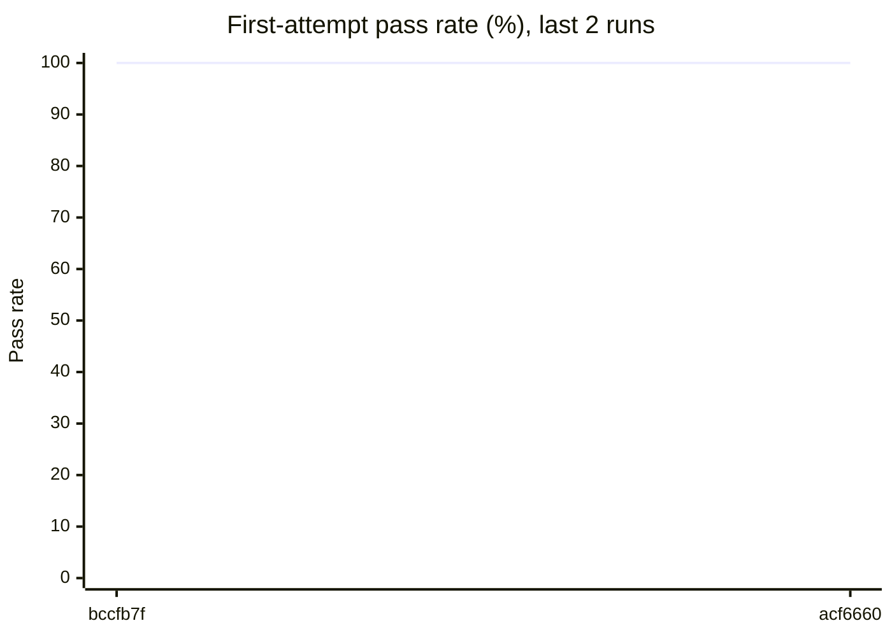
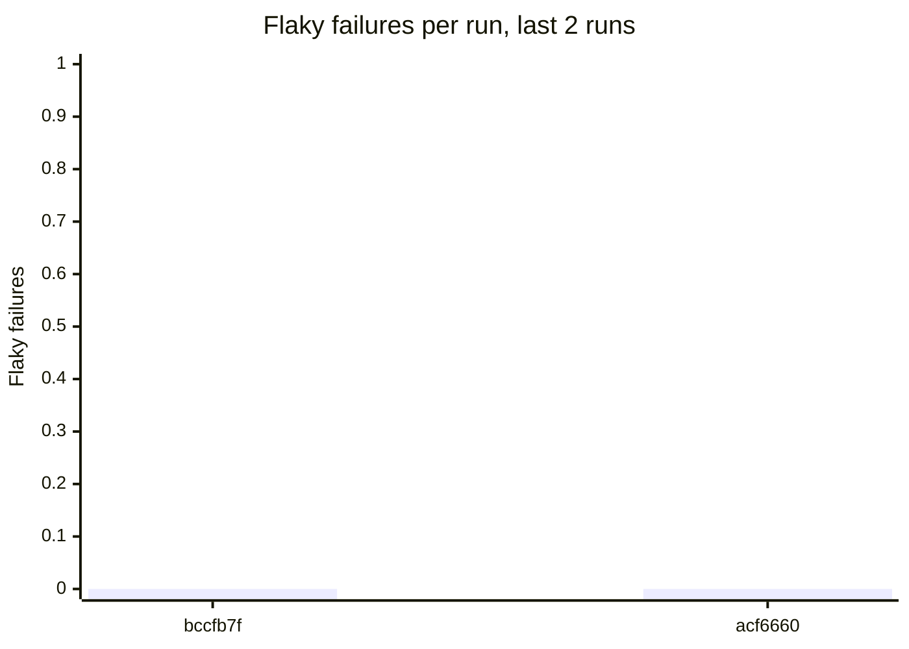
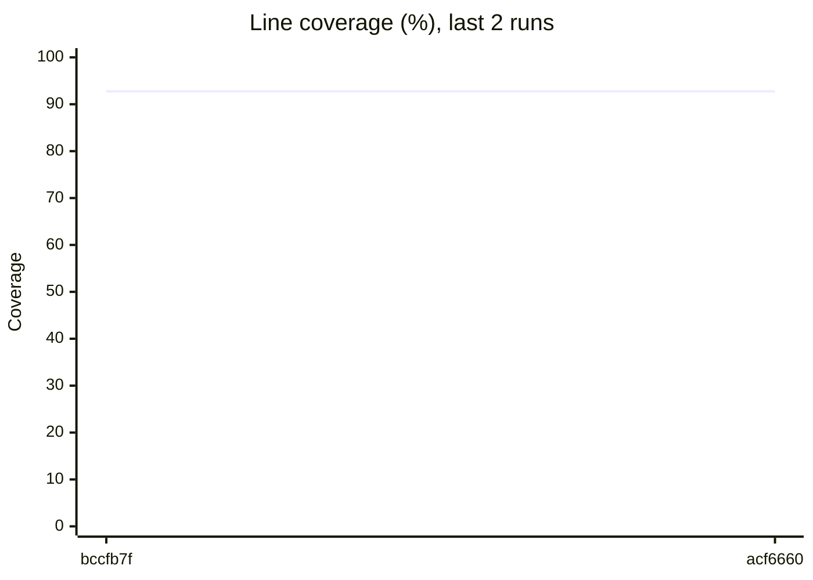

# Flaky test report

**Runs analysed:** 2 (1 on main, 1 from pull requests) · **Tests tracked:** 5 · **Flaky:** 0 (🔴 0 critical, 🟠 0 high, 🟡 0 medium, ⚪ 0 low) · **Consistently failing:** 0

## This run

main (merge of #17) · commit `acf6660` · Add flaky test detection and per-test coverage to CI (#17)

All 5 tests passed.

## Flaky tests

No flaky tests detected: no test has both passed and failed on the same code.

## Trends

## Coverage

**Total:** 92.75% of 69 statements

## Graph data

- `runs.csv`: one row per run: pass rate, failures, flaky failures, coverage, diff coverage
- `runs.json`: same as runs.csv, as JSON
- `test_outcomes.csv`: every test attempt in every run (long format, for heatmaps)
- `flaky_tests.json`: flaky and failing tests with stats, onset and per-run timeline
- `coverage_files.csv`: per-file coverage for the latest run with coverage
- `coverage_gaps.json`: files below threshold, never-executed files, uncovered changed lines
