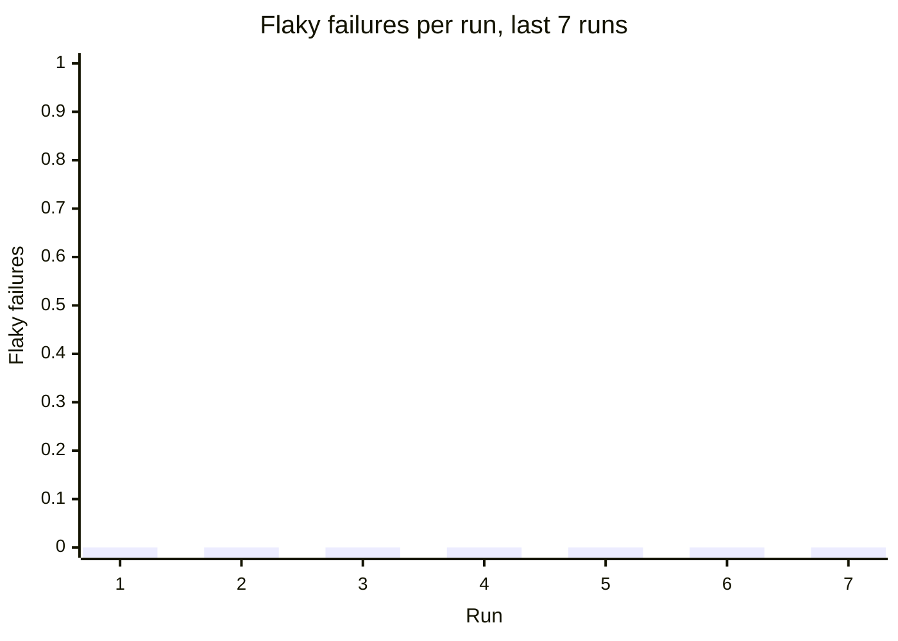

# Flaky test report

**Runs analysed:** 7 (4 on main, 3 from pull requests) · **Tests tracked:** 5 · **Flaky:** 0 (🔴 0 critical, 🟠 0 high, 🟡 0 medium, ⚪ 0 low) · **Consistently failing:** 0 · **Fixed flakes:** 0

## This run

main (merge of #20) · commit `caa8b83` · Bump astral-sh/setup-uv from 10.3.0 to 10.3.2 (#20)

All 5 tests passed.

## Flaky tests

No flaky tests detected: no test has both passed and failed on the same code.

## Trends

```mermaid
xychart-beta
    title "First-attempt pass rate (%), last 7 runs"
    x-axis "Run" [1, 2, 3, 4, 5, 6, 7]
    y-axis "Pass rate" 0 --> 100
    line [100.0, 100.0, 100.0, 100.0, 100.0, 100.0, 100.0]
```



```mermaid
xychart-beta
    title "Line coverage (%), last 7 runs"
    x-axis "Run" [1, 2, 3, 4, 5, 6, 7]
    y-axis "Coverage" 0 --> 100
    line [92.75, 92.75, 92.75, 92.75, 92.75, 92.75, 92.75]
```

<details><summary>Run key</summary>

| Run | Commit | Where | Date |
| --- | --- | --- | --- |
| 1 | `bccfb7f` | PR #17 | 2026-10-22 |
| 2 | `acf6660` | main (merge of #17) | 2026-10-22 |
| 3 | `8d451d0` | PR #18 | 2026-10-22 |
| 4 | `8df4960` | main (merge of #18) | 2026-10-22 |
| 5 | `ac3acd4` | PR #19 | 2026-10-22 |
| 6 | `8a8e29f` | main (merge of #19) | 2026-10-22 |
| 7 | `caa8b83` | main (merge of #20) | 2026-10-28 |

</details>

## Coverage

**Total:** 92.75% of 69 statements (+0.00 vs main at `8a8e29f`)

## Graph data

- `runs.csv`: one row per run: pass rate, failures, flaky failures, coverage, diff coverage
- `runs.json`: same as runs.csv, as JSON
- `test_outcomes.csv`: every test attempt in every run (long format, for heatmaps)
- `flaky_tests.json`: flaky and failing tests with stats, onset and per-run timeline
- `coverage_files.csv`: per-file coverage for the latest run with coverage
- `coverage_gaps.json`: files below threshold, never-executed files, uncovered changed lines
